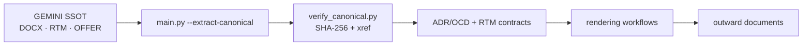

# DOCX RTM Automation

*Governed DOCX/RTM extraction, traceability and rendering.*

<!-- markdownlint-disable MD001 MD013 MD022 MD029 MD031 MD032 MD033 MD040 MD060 -->

[-orange?style=flat-square)](release/RELEASE_IDENTITY.json)
[](https://github.com/GBOGEB/DOCX_RTM_Automation/actions/workflows/python-ci.yml)
[](https://github.com/GBOGEB/DOCX_RTM_Automation/actions/workflows/typescript-orchestration-ci.yml)
[](LICENSE)

> **Turns controlled DOCX, RTM and OFFER sources into versioned canonical artefacts with SHA-256 provenance, traceability exports and rendered outward documents — the rendering member of the RTM_Documents mini-federation.**

## At a glance

| | |
|---|---|
| **Domain** | Engineering-document processing: DOCX and RTM/OFFER workbook extraction, canonical artefacts and manifests, ADR/OCD federation projections, reliability-analysis consumers, Pandoc/Lua rendering |
| **EPICs carried here** | **P0-B admission hardening** ([#86](https://github.com/GBOGEB/DOCX_RTM_Automation/issues/86)) · **Release and provenance lane** ([release identity](release/RELEASE_IDENTITY.json)) · **Wave claims** W101/W102 ([#109](https://github.com/GBOGEB/DOCX_RTM_Automation/pull/109), [#111](https://github.com/GBOGEB/DOCX_RTM_Automation/pull/111)) |
| **Owner and decision authority** | Repository owner **GBOGEB**: admission to the default branch, releases and every external grant. No agent, bot or CI verdict holds this authority. |
| **Role in the federation** | The *OUTPUT / rendering* member of the `RTM_Documents` mini-federation; [`federation.yaml`](federation.yaml) names GEMINI as its SSOT source. |
| **Owns** | Extraction and canonicalisation code in `src/`, `main.py`, canonical manifests, the ADR/OCD bridge validator, the TypeScript orchestration package, rendering workflows |
| **Does not own** | The SSOT (GEMINI) · QPS engineering content and acceptance (cryoplant-project) · federation governance (CODEX) |
| **Status snapshot** | `main@5a18a68`, read 15 November 2026 — 1 open issues, 0 open PRs. [Details ↓](#6-status-and-open-gates) |

**New here?** Read [§1](#1-why-docx_rtm_automation-exists--bios), then the route that matches you:

| I want to… | Open this first |
|---|---|
| Run the extractor | [Run it locally](#7-run-it-locally) |
| Know what is proven and what is not | [Status and open gates](#6-status-and-open-gates) and [enterprise-readiness edges](#enterprise-readiness-values-and-missing-edges) |
| Start as an agent | [`AGENT_ENTRYPOINT.md`](AGENT_ENTRYPOINT.md) → [`federation.yaml`](federation.yaml) → [`handover/CURRENT.json`](handover/CURRENT.json) |
| Check the version | [`release/RELEASE_IDENTITY.json`](release/RELEASE_IDENTITY.json) and [`CHANGELOG.md`](CHANGELOG.md) |
| Report a defect | [GitHub Issues](https://github.com/GBOGEB/DOCX_RTM_Automation/issues) |

## 1. Why DOCX_RTM_Automation exists — BIOS

**B — Baseline.** `release/RELEASE_IDENTITY.json` is the release SSOT: repository release **1.0.4** (`HARDENING`, no tag, not published); the workflow contract (2.0.0) and TypeScript package (1.0.0) are versioned independently.

**I — Identity and integrity.** Canonical extraction writes versioned artefacts with a manifest; `scripts/verify_canonical.py` checks SHA-256 and cross-references. A drift guard keeps component versions matched to their sources.

**O — Orchestration with ownership.** Agents read `AGENT_ENTRYPOINT.md`, then `federation.yaml`, then `handover/CURRENT.json`. Wave claims live in `.waves/`.

**S — Safety and source-qualified status.** "Enterprise-ready" and "production-ready" stay withdrawn until the [definition of done](#definition-of-done-for-an-enterprise-ready-claim) is evidenced. Older achievement and certification files in the root are historical, not evidence.

**Where authority lives:** [`release/RELEASE_IDENTITY.json`](release/RELEASE_IDENTITY.json) · [`federation.yaml`](federation.yaml) · [`handover/CURRENT.json`](handover/CURRENT.json) · [`configs/repository_admission_policy.json`](configs/repository_admission_policy.json) · [`AGENT_ENTRYPOINT.md`](AGENT_ENTRYPOINT.md).

## 2. From source to decision

1. Controlled sources (DOCX, RTM XLSX, OFFER XLSX and PDF tables) come from the SSOT.
2. `main.py --extract-canonical` routes each source to a versioned canonical artefact.
3. `verify_canonical.py` checks hashes, manifest and cross-references.
4. ADR/OCD bridge and RTM reconciliation contracts validate the projections.
5. Rendering workflows produce outward documents.
6. Exact-head CI and the admission policy gate the merge; the owner admits.

## 3. What is inside

| Block | Native source | Input → output | Boundary |
|---|---|---|---|
| Extraction and parsing | [`src/`](src/) (`extractors/`, `parsers/`, `document_core/`, `rtm/`), [`main.py`](main.py) | DOCX, XLSX, PDF tables → canonical artefacts | Extraction, not engineering truth |
| Canonical verification | [`scripts/verify_canonical.py`](scripts/verify_canonical.py), [`canonical/`](canonical/) | Artefacts → SHA-256, manifest, cross-reference checks | Integrity, not correctness of content |
| ADR/OCD and RTM contracts | [`contracts/`](contracts/), [`schemas/`](schemas/) | Projections → validator verdicts, traceability export | Applicability contract v0.3.1 |
| Release identity | [`release/`](release/), [`scripts/validate_release_identity.py`](scripts/validate_release_identity.py) | Versions → drift guard | No published release yet |
| TypeScript orchestration | [`orchestration_ts/`](orchestration_ts/) | Express/WebSocket server | Routes and API not yet reconciled with the federation contract |
| Admission policy | [`configs/repository_admission_policy.json`](configs/repository_admission_policy.json) | Desired protection → admission check | Not enforced live (#86) |

### Enterprise-readiness values and missing edges

The word **enterprise** is treated here as a set of verifiable controls, not a marketing label.

| Enterprise value | Required evidence | Current edge |
| --- | --- | --- |
| Authority separation | Machine-readable ownership/SSOT boundaries and fail-closed promotion rules | Present in federation/QPS surfaces; keep enforced across new consumers |
| Provenance and reproducibility | Exact source identity, hashes, manifests, deterministic transforms and exact-head receipts | Strong partial implementation; expand to every outward release product |
| Change control | Protected default branch, required checks, review policy and non-bypassable merge gates | **TODO P0:** a ruleset blocks deletion and force-push and requests Copilot review, but pull requests and required checks are not enforced ([#86](https://github.com/GBOGEB/DOCX_RTM_Automation/issues/86)) |
| Version/release governance | One authoritative repository release plus explicit component-version map, changelog binding and later binary/source receipt | Release SSOT + drift guard present; binary/source release receipt remains P1 |
| Test assurance | Current workflow/test inventory, >0-step census, regression gates and explicit coverage scope | Census recorded in `triage/ci/` (2 Oct 2026 baseline); TypeScript CI admission remains P0 |
| Security | Implemented authN/authZ, secrets handling, dependency controls, audit evidence and security tests | **TODO P1:** configuration is not proof |
| Observability | Structured logs, health signals, failure classification and retained run evidence | Partial; define supported production signals and retention |
| Performance | Repeatable benchmark harness, datasets, limits and SLOs | **TODO P1:** no governed benchmark baseline |
| Deployment | Supported packaging/runtime target with reproducible deploy and rollback proof | **TODO P1:** do not advertise Docker/Kubernetes/cloud targets until artefacts exist |
| Supportability | Named support channel, ownership, severity model and response expectations | GitHub Issues only; no SLA/commercial support contract is declared |
| Documentation truth | Root docs generated or checked against executable/configured state | **TODO P0/P1:** stale certification/achievement material remains elsewhere in repo |

### Backlog by priority

#### P0 - restore repository truth and admission controls

- [x] Reconcile version identity with `release/RELEASE_IDENTITY.json`: repository release `1.0.4` is authoritative; workflow-contract `2.0.0` and TypeScript `1.0.0` remain explicitly independent component versions and are drift-checked.
- [x] Refresh `handover/CURRENT.json` from the PR #82 / `f2527735...` baseline and advance the next control edge to P0-B admission hardening.
- [ ] Enable/enforce `main` branch protection with required exact-head checks and review rules. Repository-side policy/validation is implemented; live GitHub enforcement remains an explicit owner gate because the connected integration lacks administration write scope.
- [x] Generate the current test/workflow census at the 2 Oct 2026 baseline (`33e02e26`), including triggers, >0-step execution structure, focused coverage scope, TypeScript TEST_ADMISSION debt and false-green search.
- [ ] Audit root/current docs for unsupported `PRODUCTION READY`, `ENTERPRISE EXCELLENCE`, fixed coverage, throughput, latency and deployment claims; archive or rewrite them as historical evidence.

#### P1 - prove enterprise controls

- [ ] Convert security configuration into executable implementation and tests, or mark each control disabled/not implemented.
- [ ] Define release identity: source SHA, generated artefact hashes, provenance manifest, changelog/version binding and reproducible release receipt.
- [ ] Add governed performance benchmarks before publishing throughput, concurrency or API-latency numbers.
- [ ] Define supported deployment target(s) and add reproducible packaging/deploy/rollback evidence before advertising cloud/Kubernetes readiness.
- [ ] Bind logging/health/notification behaviour to tested runtime paths and document retention/operational ownership.
- [ ] Reconcile the TypeScript orchestration API surface with the actual server routes and current federation contract.

#### P2 - product evolution

- [ ] Re-baseline traceability, visualization, document-format and collaboration backlog against what is already implemented today.
- [ ] Promote only roadmap items with an owner, acceptance criteria, test/evidence path and dependency chain.
- [ ] Keep AI/ML/predictive features as development candidates until datasets, evaluation criteria and failure controls are defined.

### Definition of done for an enterprise-ready claim

An `enterprise-ready` or `production-ready` statement shall not be restored until all of the following are evidenced on the same current release line:

- one authoritative version/release identity;
- protected default branch with required non-bypassable checks;
- exact-head CI with >0-step execution and explicit test/coverage scope;
- source/provenance hashes for governed inputs and generated release artefacts;
- executable security controls with tests and secrets/dependency handling;
- documented supported runtime/deployment target with rollback/recovery evidence;
- governed performance/SLO measurements rather than hard-coded marketing numbers;
- current operational ownership/support path;
- no known stale root status, handover or certification surface contradicting the release state.

## 4. Where DOCX_RTM_Automation sits in the federation

| Neighbour | Keeps | Interface with DOCX_RTM_Automation |
|---|---|---|
| [GEMINI](https://github.com/GBOGEB/GEMINI) | SSOT source for RTM_Documents | Supplies controlled inputs |
| [cryoplant-project](https://github.com/GBOGEB/cryoplant-project) (private) | QPS engineering SSOT and release identity | Consumes QPS/ADR/OCD projections |
| [document-organization-system](https://github.com/GBOGEB/document-organization-system) | Outward artefact worker | Hosts the `adapters/docx_rtm` bridge |
| [CODEX](https://github.com/GBOGEB/CODEX) | Federation governance, contracts, wave roll-up | Rolls up this repo's wave claims |

## 5. Process diagrams

Declared architecture, not a run receipt.



## 6. Status and open gates

**Snapshot: `main@5a18a68`, read 15 November 2026.** Rows point at live owners; open the link for the current position.

| Gate | Status | What would close it |
|---|---|---|
| `main` protection | Ruleset blocks deletion and force-push and requests Copilot review; **PR-required and required checks not enforced** | Owner enables non-bypassable protection ([#86](https://github.com/GBOGEB/DOCX_RTM_Automation/issues/86)) |
| Release | 1.0.4 declared, **no tag or release** | Source-to-artefact manifest with SHA-256 receipts, then a tagged release |
| Security | JWT/RBAC/encryption declared in configuration but **unproven** in code | Executable controls with tests, or relabel as not implemented |
| Root documentation | Legacy achievement/certification files remain in the root | Archive or rewrite as historical |
| Dependencies | Advisory fixes merged ([#103](https://github.com/GBOGEB/DOCX_RTM_Automation/pull/103), [#107](https://github.com/GBOGEB/DOCX_RTM_Automation/pull/107), [#108](https://github.com/GBOGEB/DOCX_RTM_Automation/pull/108)), but GitHub still reported **221 open Dependabot alerts** on `main` (10 critical, 114 high) on 15 Nov 2026 | Triage by manifest: used vs unused, then lock or remove |
| Not claimed | Cloud/Kubernetes deployment, performance or SLA figures | Evidence before any claim |

## 7. Run it locally

Python **3.12** is the main CI leg (`pyproject.toml` allows ≥ 3.8). From the repository root:

```bash
python -m pip install --require-hashes -r requirements/requirements.lock
python main.py                        # standard DOCX processing
python main.py --extract-canonical    # canonical extraction
python scripts/verify_canonical.py
python scripts/validate_release_identity.py
```

TypeScript orchestration:

```bash
cd orchestration_ts && npm ci && npm run build && npm test
```

A local pass is not readiness; exact-head CI and repository controls are.

## 8. Evidence rules and non-compensation

- **Configuration is not proof**: declared controls count only with code and tests.
- **No fixed marketing numbers**: performance needs a governed benchmark.
- **One release identity**: `RELEASE_IDENTITY.json` wins over any other version string.
- **Roadmap items need an owner, acceptance criteria and an evidence path.**

## 9. Repository map and next actions

| Folder | Open it for |
|---|---|
| [`src/`](src/) | Extraction, parsing, RTM, analyzers |
| [`scripts/`](scripts/) | Verification and release tools |
| [`contracts/`](contracts/), [`schemas/`](schemas/) | Federation contracts |
| [`orchestration_ts/`](orchestration_ts/) | TypeScript orchestration |
| [`tests/`](tests/) | Tests |
| [`release/`](release/), [`handover/`](handover/) | Identity and handover |
| [`triage/`](triage/) | CI census and triage |
| [`archive/`](archive/) | Historical material |

**Next actions** (match §6): owner enables protection (#86) → TypeScript test admission → security proof lane → release/provenance manifest → archive legacy root documents.

---

BIOS: Baseline · Identity · Orchestration · Safety. Admission authority: **GBOGEB**. Licence: [Apache-2.0](LICENSE). Support: GitHub Issues; no SLA is declared. Landing R2 on the [GEMINI skeleton](https://github.com/GBOGEB/GEMINI/blob/main/docs/landing/LANDING_SKELETON.md), snapshot `main@5a18a68`.
